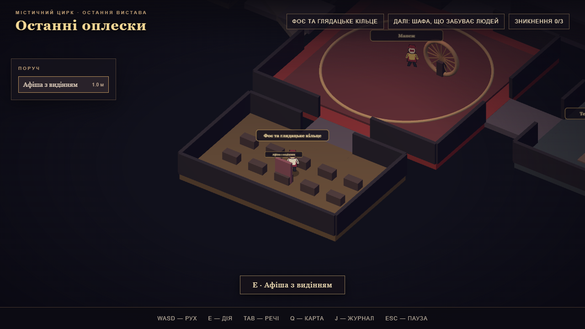

# Останні оплески

Локальна містична гра про останню виставу цирку. Після видіння гравець досліджує сім зон, домовляється про перестановку трьох номерів, спостерігає, як цирк зникає, і готує один із двох способів пережити фінал із колесом та ножами. Зараз художні файли замінюють створені кодом анімовані заглушки.

**Готова гра для Windows x64:** [завантажити portable-версію з релізу](https://github.com/XxKotfeJxX/last-applause-game/releases/latest). Встановлення Node.js для запуску `.exe` не потрібне.



[Постановка фіналу з двійником](docs/preview-finale.png)

## Вимоги й запуск

- Windows x64 для настільного пакування; браузер із WebGL2 для вебверсії.
- Node.js 20.19.5 або сумісна 20 LTS; версія в [.nvmrc](.nvmrc).
- Зафіксовані версії: Three.js 0.180.0, TypeScript 5.9.2, Vite 7.1.7, Electron 38.1.2, electron-builder 26.0.12. Повний список у `package-lock.json`.

```powershell
npm ci
npm run dev:web
npm run dev:desktop
npm run check
npm run test:e2e
npm run build:web
npm run build:desktop
npm run pack:win
node tools/portable-smoke.mjs
```

`dev:web` відкриває Vite за адресою, надрукованою в консолі. `dev:desktop` запускає Vite й Electron разом. Результат вебзбірки: `dist-web/`; Windows portable: `release/` після `pack:win`. Пакет працює локально через `app://game/`. Дані зберігаються в `localStorage` цього origin (`last-applause:v1:manual` і `last-applause:v1:checkpoint`), який Electron тримає в профілі користувача, а не поряд із `.exe`. У вебверсії збереження прив’язані до origin вебсервера; перенесення між origin автоматично не підтримується.

## Керування

WASD / стрілки — рух; E — найближча ціль; Tab/I — речі; Q — карта; J — журнал; Esc — пауза. Цілі поруч також можна обрати мишею. У діалогах, журналі, інвентарі й паузі світ зупиняється. Під час останнього номера сценічний сигнал має 12 секунд.

## Проходження

Афіша висить у закуліссі. Для перестановки попросіть майбутнього артиста виступити зараз, отримайте згоду поточного, потім попросіть конферансьє оголосити зміну. Для кожного номера підготуйте його механізм: шафу в гримерці, лебідку на галереї або колесо в манежі. Конферансьє викликає артиста; дочекайтеся його виходу на манеж і подайте два сигнали. Усі шість порядків проходяться.

Після трьох номерів конферансьє проводить останню перевірку. Маршрут сценічних ножів вимагає запису в Рози, підміни після перевірки, червоної фарби й маски. Маршрут двійника вимагає доставити манекен, костюм і маску, підготувати затемнення на галереї та відкрити прихований вихід у підпіллі. Смерть пояснює конкретну відсутню умову, після неї доступна контрольна точка.

## Структура

- `content/` — дані зон, NPC, предметів, номерів, діалогів і рольових прив’язок.
- `src/domain/`, `src/simulation/` — авторитетний світ, правила й маршрути без Three.js, DOM чи Electron.
- `src/render/`, `src/ui/` (DOM зібрано в `src/main.ts`), `src/audio/` — представлення та звук.
- `public/assets/` — пакети художніх файлів. Порожні слоти використовують процедурні заглушки.
- `tools/` — sync, валідація, генератори; `electron/` — ізольований настільний оболонка.
- `docs/` — правила контенту, асетів, збережень, тестів і обмежень.

## Асети й контент

`npm run content:sync` збирає статичний каталог із наявних файлів. `npm run content:validate` перевіряє посилання; `npm run assets:validate` перевіряє метадані та PNG, а `-- --require-final` перетворює відсутні файли на помилки. `npm run assets:preview` відкриває локальний перегляд пакетів. `new:npc`, `new:item`, `new:act` створюють шаблони без перезапису існуючих ID. Точні кроки: [ASSET_INTEGRATION](docs/ASSET_INTEGRATION.md) та [CONTENT_AUTHORING](docs/CONTENT_AUTHORING.md).

`npm run assets:proof` тимчасово створює контрольний PNG для ходьби Гната, перевіряє його завантаження у браузері тільки для цього NPC, потім видаляє файл і відновлює каталог.

## Стан

Реалізовано ігровий цикл P0 з двома розв’язками фіналу, процедурними персонажами й локальним збереженням. Перший художній реліз, P1/P2, довше сюжетне проходження та ручне тестування на чужому обладнанні не виконані. Фактичні перевірки й обмеження: [TEST_REPORT](docs/TEST_REPORT.md), [KNOWN_LIMITATIONS](docs/KNOWN_LIMITATIONS.md).
